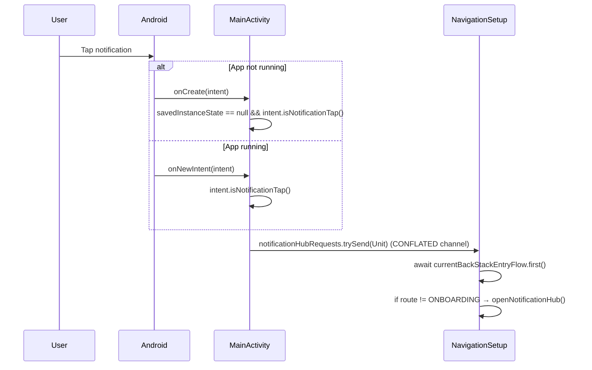

# Push Notifications on Android — Spec & Implementation Guide

This document describes how Eatery Blue Android does push notifications end to end, and is written so that someone building notifications in another Android app (or porting this one) can follow the same design. It covers the backend contract, every client component, the runtime flows, the edge cases we hit, and how to test.

**Stack:** Firebase Cloud Messaging (FCM) · Kotlin · Jetpack Compose · Hilt · Retrofit/Moshi · Proto DataStore · `minSdk 28`, `targetSdk 37`.

---

## 1. Goals and scope

| In scope | Out of scope |
| --- | --- |
| Receive FCM pushes and show them as heads-up notifications | Scheduling notifications locally (`AlarmManager`/`WorkManager`) |
| Register the device's FCM token with our backend | Rich media (images, action buttons, reply) |
| Ask for `POST_NOTIFICATIONS` (API 33+) at a sensible moment | Multiple channels per category |
| Tapping a push opens the in-app **Notification Hub** | Deep-linking to a specific eatery/item from a push |
| A Hub screen listing the last 24 h of notifications, with unread state | |
| In-app settings: *Pause all*, *Favorite items*, *Cornell AppDev* | |
| Sync favorite items to the backend (it decides what to send) | |

**Who decides what gets sent?** The **backend**. The client registers a token, reports favorites and settings, and displays whatever arrives. The client never filters by category — category settings are enforced server-side.

---

## 2. Architecture

```mermaid
flowchart LR
    subgraph Backend
      API[Eatery API]
      FCMsend[FCM send]
    end
    subgraph Google
      FCM[(FCM)]
    end
    subgraph App
      App[EateryBlueApplication<br/>creates channel]
      Svc[EateryMessagingService]
      Act[MainActivity<br/>permission + token sync + tap routing]
      Repo[NotificationRepository]
      Perm[NotificationPermissionChecker]
      Prefs[(UserPreferences<br/>DataStore)]
      Fav[FavoriteItemSyncRepository]
      Hub[NotificationsHomeScreen]
      Set[NotificationsSettingsScreen]
    end

    API --> FCMsend --> FCM --> Svc
    FCM -- background: system tray --> Act
    Svc --> Repo
    Act --> Repo
    Repo --> Perm
    Repo --> Prefs
    Repo <--> API
    Fav <--> API
    Hub --> Repo
    Set --> Repo
```

### Component map

| Component | File | Responsibility |
| --- | --- | --- |
| Notification channel | [EateryBlueApplication.kt](../app/src/main/java/com/cornellappdev/android/eatery/EateryBlueApplication.kt) | Creates `eatery_alerts` channel with `IMPORTANCE_HIGH` on app start. |
| Messaging service | [EateryMessagingService.kt](../app/src/main/java/com/cornellappdev/android/eatery/notifications/EateryMessagingService.kt) | `onMessageReceived` (builds the notification while foregrounded) and `onNewToken`. Also defines `Intent.isNotificationTap()`. |
| Permission checker | [NotificationPermissionChecker.kt](../app/src/main/java/com/cornellappdev/android/eatery/notifications/NotificationPermissionChecker.kt) | `needsPermissionRequest()` and `areNotificationsAllowedBySystem()`. Injectable so it can be faked in tests. |
| Repository | [NotificationRepository.kt](../app/src/main/java/com/cornellappdev/android/eatery/data/repositories/NotificationRepository.kt) | Token registration, hub fetch/mark-read, settings load/update, pause logic. Single source of truth for the UI. |
| Favorites sync | [FavoriteItemSyncRepository.kt](../app/src/main/java/com/cornellappdev/android/eatery/data/repositories/FavoriteItemSyncRepository.kt) | Queues favorite item add/remove in DataStore and retries until the backend accepts it. |
| Activity glue | [MainActivity.kt](../app/src/main/java/com/cornellappdev/android/eatery/MainActivity.kt) | First-run permission prompt, token sync on resume, routes taps to the hub. |
| Navigation | [MainTabbedNavigation.kt](../app/src/main/java/com/cornellappdev/android/eatery/ui/navigation/MainTabbedNavigation.kt) | Collects hub-open requests and navigates once the graph is ready. |
| Hub UI | `NotificationsHomeScreen.kt`, `NotificationsHomeViewModel.kt`, `components/notifications/NotificationRow.kt` | List, unread styling, pull-to-refresh, empty/error states. |
| Settings UI | `NotificationsSettingsScreen.kt`, `NotificationsSettingsViewModel.kt` | Toggles, OS-off banner with *Open Settings*, sync-error snackbar. |
| Local state | [user_prefs.proto](../app/src/main/proto/user_prefs.proto) | Fields 19–24 (see §6). |
| API | [NetworkingApi.kt](../app/src/main/java/com/cornellappdev/android/eatery/data/NetworkingApi.kt) | Endpoints in §3. |

---

## 3. Backend contract

All endpoints require a bearer access token. Calls go through `AuthTokenRepository.authorizedNetworkCall { … }`, which **waits until launch-time token setup has finished** before sending, so callers never race auth.

| Method & path | Body | Response | Used for |
| --- | --- | --- | --- |
| `POST /users/fcm-token` | `{"token": "<fcm token>"}` | — | Register this device for pushes |
| `GET /users/notifications` | — | `{"notifications": [{"id": 1, "body": "…", "isRead": false}]}` | Hub list: last 24 h, newest first |
| `PATCH /users/notifications/read` | `{"ids": [1, 2]}` | — | Mark hub entries read |
| `GET /users/settings` | — | `{"favoriteItemPushNotifications": true, "cornellAppdevPushNotifications": true}` | Load category settings |
| `PATCH /users/settings` | Any non-empty subset of the two fields above | Full settings | Update a category. Unknown fields are rejected; at least one field is required. |
| `POST /users/favorites/items` | `{"name": "<item name>"}` | — | Favorite added |
| `DELETE /users/favorites/items` (with body) | `{"name": "<item name>"}` | — | Favorite removed |

Notes:

- **There is no server-side master switch.** "Pause all" is implemented client-side by turning both categories off on the server (see §5.5).
- The backend **keeps tokens regardless of settings**, so the client never unregisters a token when pausing.
- `GET /users/notifications` returning **404** means the backend build doesn't support the hub yet. The client hides the bell in release builds in that case (`hubAvailableFlow`).
- Hub `body` may contain `**bold**` spans (e.g. `**Chicken Nuggets** is being served at Becker House at 5:35 PM!`). `NotificationRow` renders them bold and strips the markers; an unmatched `**` is left as-is.

### Push payload

The backend sends a payload with a `notification` block and click action `FLUTTER_NOTIFICATION_CLICK` (a legacy name shared with other clients — Android only needs it to match the manifest intent filter):

```json
{
  "notification": {
    "title": "Eatery",
    "body": "**Chicken Nuggets** is being served at Becker House at 5:35 PM!",
    "click_action": "FLUTTER_NOTIFICATION_CLICK"
  },
  "data": { "body": "…optional, used for data-only pushes…" }
}
```

The client reads `notification.body`, falling back to `data["body"]`. **The title is ignored** when the app builds the notification, because Android already shows the app name in the header and "Eatery" would appear twice.

---

## 4. Setup checklist (new project)

1. **Firebase**
   - Add the app in the Firebase console and drop `google-services.json` into `app/`.
   - Root `build.gradle`: `id 'com.google.gms.google-services' version '4.4.4' apply false`
   - App `build.gradle`: apply `com.google.gms.google-services`, and add
     ```groovy
     implementation platform('com.google.firebase:firebase-bom:34.12.0')
     implementation 'com.google.firebase:firebase-messaging'
     ```
2. **Manifest** ([AndroidManifest.xml](../app/src/main/AndroidManifest.xml))
   ```xml
   <uses-permission android:name="android.permission.POST_NOTIFICATIONS" />

   <application ...>
       <!-- Channel FCM uses when the *system* displays a background push -->
       <meta-data
           android:name="com.google.firebase.messaging.default_notification_channel_id"
           android:value="@string/fcm_default_channel_id" />

       <activity android:name=".MainActivity" android:exported="true" ...>
           <!-- Must match the backend's click_action, or background taps won't route here -->
           <intent-filter>
               <action android:name="FLUTTER_NOTIFICATION_CLICK" />
               <category android:name="android.intent.category.DEFAULT" />
           </intent-filter>
       </activity>

       <service
           android:name=".notifications.EateryMessagingService"
           android:exported="false">
           <intent-filter>
               <action android:name="com.google.firebase.MESSAGING_EVENT" />
           </intent-filter>
       </service>
   </application>
   ```
3. **Strings**: `fcm_default_channel_id = eatery_alerts`, `fcm_default_channel_name = Eatery Notifications`. The channel name is user-visible in system settings.
4. **Small icon**: a monochrome drawable (`ic_eaterylogo_blue`). Colored/full-bleed icons render as a white square.
5. **Channel**: create it in `Application.onCreate()` (cheap and idempotent). No API-level guard is needed since `minSdk ≥ 26`.
6. **Feature flag**: `buildConfigField("boolean", "ENABLE_NOTIFICATIONS", "true")` per build type gates the bell in the UI.

---

## 5. Runtime behavior

### 5.1 Receiving a push

Android delivers FCM messages differently depending on app state and payload type. This is the single most confusing part of FCM, so design for all four cells:

| | `notification` payload | data-only payload |
| --- | --- | --- |
| **App foregrounded** | `onMessageReceived` runs → **we** build the notification | `onMessageReceived` runs → we build it |
| **App backgrounded / killed** | **System** shows it in the tray using the default channel; `onMessageReceived` is *not* called | `onMessageReceived` runs → we build it |

When **we** build it (`EateryMessagingService.sendNotification`):

1. Bail out unless `NotificationRepository.canShowNotifications()` — the user hasn't paused in-app **and** the OS allows notifications.
2. Build a `PendingIntent` to `MainActivity` with `FLAG_ACTIVITY_CLEAR_TOP`, extra `open_notification_hub = true`, and `FLAG_IMMUTABLE | FLAG_UPDATE_CURRENT` (immutable is required on API 31+).
3. `NotificationCompat.Builder` on `eatery_alerts`: body only, `BigTextStyle` so long text expands, default sound, auto-cancel.
4. `notify()` with a time-based id so multiple pushes stack instead of replacing each other.

> **Known asymmetry:** pushes the *system* displays (background, `notification` payload) still show the backend's title, and are shown even if the user paused in-app — which is why pausing also turns the categories off server-side (§5.5). If you need full client control, have the backend send data-only messages.

### 5.2 Tapping a push



`Intent.isNotificationTap()` is true if **any** of these hold, covering both who-built-it cases:

- `action == "FLUTTER_NOTIFICATION_CLICK"` (system-shown push with click action)
- extra `open_notification_hub == true` (push we built)
- extras contain `google.message_id` (any system-shown FCM push)

Design decisions:

- **Conflated `Channel`** buffers the request so a cold-start tap isn't lost before Compose/NavHost exists, and repeated taps collapse into one.
- **Skip on recreation** (`savedInstanceState != null`) so rotating the device doesn't reopen the hub.
- **Wait for the nav graph** (`currentBackStackEntryFlow.first()`) before navigating on cold start.
- **Don't interrupt onboarding.** The live route is checked at delivery time.
- `openNotificationHub()` is a no-op if already on the hub, otherwise navigates via Home so Back returns somewhere sensible.

### 5.3 Permission (API 33+)

`POST_NOTIFICATIONS` is a runtime permission only on API 33+; below that it's granted at install but the user can still disable notifications in system settings. Two checks, two meanings:

| Method | Meaning |
| --- | --- |
| `needsPermissionRequest()` | API 33+ and not yet granted. Always `false` below 33. |
| `areNotificationsAllowedBySystem()` | `NotificationManagerCompat.areNotificationsEnabled()` — the real "will the OS show it" answer on every API level. |

**When we ask:**

1. **First launch, after onboarding.** `MainActivity.requestNotificationPermissionIfNeeded()` waits on `hasOnboardedFlow.first { it }` so the dialog doesn't cover intro screens, then prompts **once** (guarded by `notificationPermissionRequested` in DataStore, which is set *before* launching the prompt).
2. **From settings.** Un-pausing on API 33+ while permission is missing launches the prompt; if granted, the un-pause is applied.
3. After a denial (or below API 33 with notifications disabled), the settings screen disables the toggles and shows *"Notifications are turned off"* with **Open Settings** → `Settings.ACTION_APP_NOTIFICATION_SETTINGS` with `EXTRA_APP_PACKAGE`.

Why `permissionRequested` matters: before the first prompt on API 33+, the permission is "not granted" but the user hasn't actually said no. The settings screen treats that state as *not denied*, so un-pausing prompts instead of sending the user to system settings.

### 5.4 Token registration

```mermaid
sequenceDiagram
    participant A as MainActivity / Service
    participant F as FirebaseMessaging
    participant R as NotificationRepository
    participant B as Backend
    A->>A: onResume (and permission granted, and onNewToken)
    A->>A: areNotificationsAllowedBySystem()? else stop
    A->>F: token
    F-->>A: token
    A->>R: registerFcmToken(token)
    R->>R: mutex; skip if == registeredFcmToken
    R->>B: POST /users/fcm-token (after auth ready)
    B-->>R: 2xx → remember token / error → log, retry next resume
```

Triggers: every `onResume` (catches the user enabling notifications in system settings while away, and retries earlier failures), after the permission prompt is granted, and `onNewToken` in the service.

Rules:

- Register only when the OS allows notifications — no point otherwise.
- Register **even when paused in-app**; the backend keeps tokens regardless, so un-pausing needs no re-registration.
- A `Mutex` + last-registered-token cache dedupe concurrent startup/resume calls. The cache is in-memory, so each process start re-registers once (intentional: cheap, self-healing).

### 5.5 Settings and "Pause all"

Local state lives in DataStore; the backend's values decide what's sent.

- **Load** (`loadSettings`, on every settings-screen resume): overwrite local categories with the server's — *unless* paused (server values are all `false` then, not the user's real choices) or a toggle is still in flight (local is newer).
- **Toggle a category**: write locally immediately (instant UI), then `PATCH` under a mutex so requests go out in tap order. Rapid toggles collapse to the newest. On failure, revert locally — unless a newer toggle superseded it — and show the *"Couldn't update notification settings"* snackbar.
- **Pause all**: `PATCH` both categories to `false`; local category values are kept. **Un-pause**: `PATCH` the locally stored category values back. The token stays registered throughout.
- `canShowNotifications()` also checks the local pause flag, as a client-side backstop for foreground pushes.

### 5.6 Notification Hub

- Fetched by Home (to drive the bell's red dot) and on hub open; cached in `NotificationRepository.notificationsFlow` so the hub shows instantly.
- On a successful fetch, unread ids are **marked read on the server immediately** (clearing the bell dot), but keep their unread styling for the rest of the visit so the user can still see what's new. Failures retry next visit.
- Pull-to-refresh keeps the current list visible; a failure leaves it unchanged.
- States: `Loading` (shimmer) → `Loaded(list | empty)` or `Error` (with Try Again). Cached data beats loading/error.
- The bell shows when `ENABLE_NOTIFICATIONS && (DEBUG || hubAvailable)`.

### 5.7 Favorite-item sync

Favorite-item notifications only work if the backend knows the user's favorites. `FavoriteItemSyncRepository`:

- Writes each add/remove to `pendingFavoriteItemUpdates` (DataStore) first, then sends it. Cleared only on success and only if the item wasn't toggled again mid-request.
- Per-item mutex so a quick re-toggle is sent right after the in-flight request.
- On resume, retries everything pending; on first run after upgrade, queues pre-existing local favorites once (`favoriteItemsMigratedToBackend`).

---

## 6. Persisted state (`user_prefs.proto`)

| Field | # | Notes |
| --- | --- | --- |
| `notificationsDisabled` | 19 | "Pause all". Stored as *disabled* so existing users default to enabled (proto3 bool default is `false`). |
| `favoriteItemNotificationsDisabled` | 20 | Same inversion trick. |
| `notificationPermissionRequested` | 21 | Prompt shown once; distinguishes "never asked" from "denied". |
| `appDevNotificationsDisabled` | 22 | |
| `pendingFavoriteItemUpdates` | 23 | `map<string,bool>` retry queue. |
| `favoriteItemsMigratedToBackend` | 24 | One-time migration guard. |

Reads use `firstOrOnReadFailure(default)` so a corrupt/unreadable DataStore degrades to a safe default instead of crashing. Pick the default per call site (e.g. "assume already prompted" → don't re-prompt).

---

## 7. Gotchas we hit

- **Double title.** Android shows the app name in the header; adding a "Eatery" title duplicated it. Foreground notifications now omit the title.
- **Click action must match the manifest.** Without the `FLUTTER_NOTIFICATION_CLICK` intent filter, tapping a background push just launches the app and the hub never opens.
- **`google.message_id` check.** System-shown pushes without a click action still carry this extra; checking it catches those taps.
- **Rotation reopening the hub.** Fixed by ignoring the launch intent when `savedInstanceState != null`.
- **Prompt over onboarding.** Fixed by awaiting `hasOnboarded`.
- **Auth race on launch.** Token/favorites calls fired before `/auth/verify-token` finished got 401s. Fixed with `authorizedNetworkCall`, which waits for token setup.
- **Backend not deployed.** Hub 404 → hide the bell in release instead of showing a broken screen.
- **Emulator networking.** Android 17 emulators block `10.0.2.2`; for a local backend use `adb reverse tcp:<port> tcp:<port>` and `localhost`. Debug builds allow cleartext via `app/src/debug/AndroidManifest.xml`.
- **`PendingIntent` mutability.** `FLAG_IMMUTABLE` is mandatory on API 31+.
- **Icon.** The small icon must be monochrome with transparency.

---

## 8. Testing

The `emulator-test` skill (`.claude/skills/emulator-test/SKILL.md`) automates most of this.

**Useful commands**

```bash
# Grant / revoke / reset the runtime permission
adb shell pm grant com.cornellappdev.android.eatery android.permission.POST_NOTIFICATIONS
adb shell pm revoke com.cornellappdev.android.eatery android.permission.POST_NOTIFICATIONS
adb shell pm clear-permission-flags com.cornellappdev.android.eatery android.permission.POST_NOTIFICATIONS user-set user-fixed

# Did a push arrive, and what was posted?
adb logcat -s EateryMessagingService:D FirebaseMessaging:D
adb shell dumpsys notification --noredact | grep -A12 "pkg=com.cornellappdev.android.eatery"
```

If a push doesn't arrive within ~60 s on an emulator, toggle airplane mode to kick the Google Play services connection. Sending a test push requires Firebase project access (console "Send test message" with the device token, or the backend's service account).

**Manual checklist**

- [ ] Fresh install (API 33+): no prompt during onboarding; prompt appears right after; not shown again on relaunch.
- [ ] Deny → settings shows "Notifications are turned off", toggles disabled, *Open Settings* opens the app's notification page; enabling there and returning re-enables toggles and registers the token.
- [ ] API ≤ 32: no prompt; disabling in system settings shows the off state.
- [ ] `POST /users/fcm-token` sent once per launch, not on every resume.
- [ ] Foreground push: heads-up, no duplicated title, long text expands.
- [ ] Background push and killed-app push: tap opens the hub; cold start doesn't crash or land on Home.
- [ ] Tap during onboarding stays on onboarding.
- [ ] Rotate on the hub after a tap → hub doesn't re-push.
- [ ] Pause all → `PATCH` with both `false`; foreground pushes suppressed. Un-pause restores prior category values.
- [ ] Toggle offline → snackbar, toggle reverts.
- [ ] Hub: unread rows styled, bell dot clears after visiting, pull-to-refresh works, empty and error states render.
- [ ] Favorite an item offline, relaunch online → `POST /users/favorites/items` retried.

---

## 9. Porting to another app — minimal path

1. Firebase + manifest + channel + icon (§4).
2. A `FirebaseMessagingService` that builds a notification in `onMessageReceived` and registers in `onNewToken` (§5.1).
3. A permission checker with the two methods in §5.3, and a once-only prompt at a calm moment.
4. Token sync on resume, deduped, after auth is ready (§5.4).
5. Tap routing via a conflated channel → navigation (§5.2).
6. Decide with your backend: **who filters** (server, recommended) and **payload type** (data-only if you need client control in the background).
7. Then layer on settings (§5.5), a hub (§5.6), and any domain sync like favorites (§5.7).
